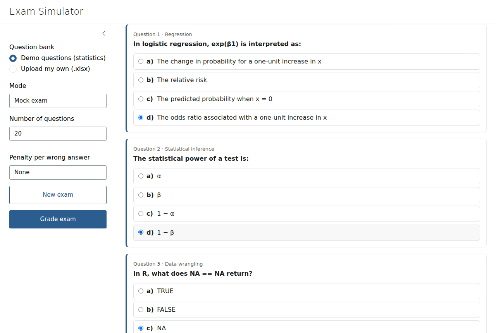
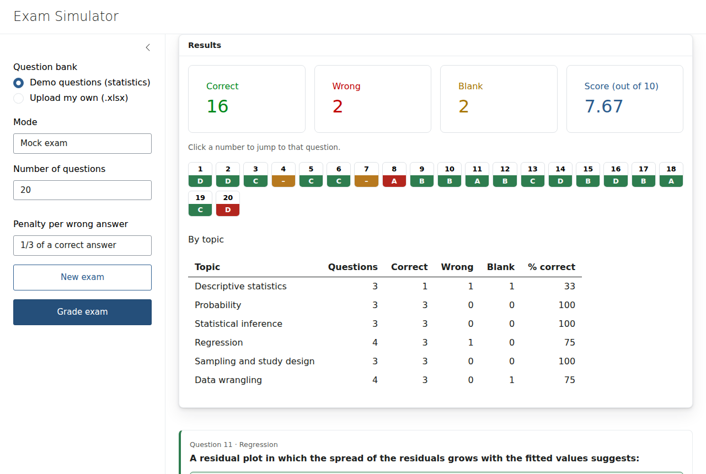

# Exam Simulator

A Shiny app for practising multiple-choice exams from any question bank stored in Excel.

I originally built it to help a friend prepare for a civil-service exam in Spain, where candidates train with banks of thousands of questions and wrong answers carry a penalty. This version is generic: it ships with a small demo bank of statistics questions, and you can upload your own spreadsheet.

**Live demo:** https://borjalafuente.shinyapps.io/shiny-exam-simulator/



## Features

- **Mock exam mode:** a random selection of *n* questions that includes at least one question from every topic.
- **Study mode:** every question of a single topic, in the original order.
- **Grading with an optional penalty** for wrong answers (none, 1/3 or 1/4 of a correct answer), and a score out of 10.
- **Results overview:** a clickable grid of every question (correct, wrong or blank) that jumps straight to it, plus a breakdown by topic to see where to focus.
- **Bring your own questions:** upload an `.xlsx` file. Numbering left over from scanned material (`"12. ..."`, `"b) ..."`) is stripped, and incomplete rows are skipped.



## Question bank format

One row per question, with these columns:

| topic | question | option_a | option_b | option_c | option_d | answer |
|---|---|---|---|---|---|---|
| Probability | What is the expected value of a roll of a fair die? | 3 | 4 | 21 | 3.5 | d |

- `answer` is the letter of the correct option (`a`–`d`).
- Topics appear in the app in the order they first appear in the file.
- Spanish headers (`Tema`, `Pregunta`, `Respuesta a`…`Respuesta d`, `Solución`) are also accepted.

`data/demo_questions.xlsx` is a complete example: 48 original questions across six topics (descriptive statistics, probability, inference, regression, study design and data wrangling).

## Running it locally

```r
install.packages(c("shiny", "bslib", "dplyr", "stringr", "readxl"))
shiny::runApp()
```

## Project structure

```
app.R               UI and server
R/questions.R       reading and validating the bank, building exams, scoring
R/components.R      HTML for question cards and the results grid
www/                stylesheet and a small JavaScript helper for scrolling
data/               demo question bank
```

The data logic in `R/questions.R` has no Shiny dependency, so it can be tested and reused on its own. Answers are sent through a single Shiny input instead of one input per question. This keeps the server simple, even with banks of thousands of questions.

## Tech

R · Shiny · bslib · dplyr · stringr · readxl

## License

MIT
